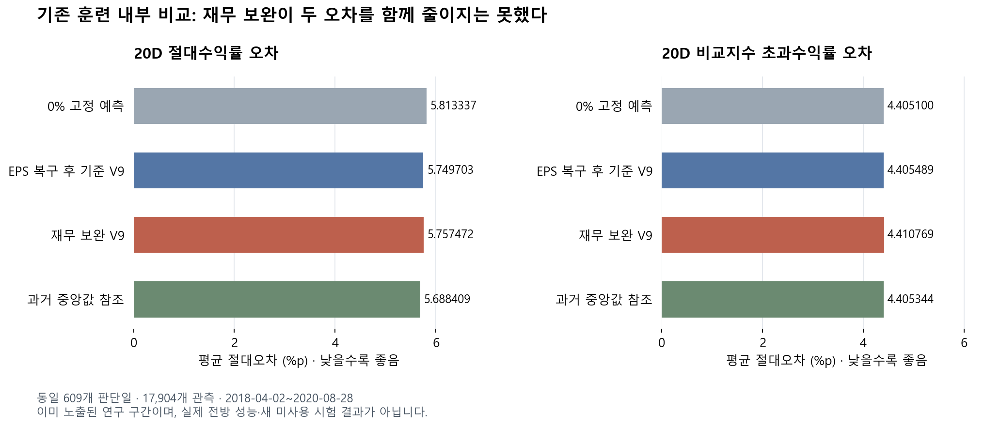

# 데이터와 검증 기반은 개선됐지만, 더 정확한 20D 모델은 아직 입증되지 않았다

검수 기준: 2026-11-03 KST. 대상은 10월 17일 검수 이후의 Quant 가격·재무·V2–V9·20D 연구·전방 수집 및 평가 작업이다. 과거 홈페이지/3D 디자인은 이번 범위가 아니다. 기존 [10월 17일 검수](quant-audit-2026-10-17.md)의 후속 종합 검수이며, 그 문서를 덮어쓰지 않는다.

## 요약

- **실제 성과:** 가격 오류 수정, 잘못된 재무 기간 격리, EPS 355건 복구, IFRS 35개 재무제표 반영, 재현 가능한 시간순 평가와 전방 예측 동결이 구현됐다. 단순히 문서만 늘어난 것은 아니다.
- **목표 달성 여부:** 실제 미래의 20거래일 예측 오차를 줄인 개선 모델은 아직 없다. 최신 전체 재무 보완 실험의 주 평가 MAE는 절대수익률 **5.757472%p**, 초과수익률 **4.410769%p**로, 비교 기준 V9보다 둘 다 소폭 나빠졌다. 현재 운영 모델을 개선 후보로 교체할 근거는 없다.
- **현재 상태:** 기준 전방 관측 1,257개와 별도 후보 비교 30개는 모두 만기 전이다. 이는 독립 표본 1,287개가 아니다. 지수·날짜가 겹치며 후보 30개는 기존 DOW30과 같은 정답을 공유한다.
- **다음 순서:** 전방 평가가 끊기지 않도록 운영 예외와 거래 종료 처리를 먼저 보완하고, 연구 자료와 운영 입력을 일치시킨 뒤, 미사용 평가 구간 또는 충분히 누적된 전방 자료로 검증해야 한다. 같은 과거에서 가중치를 계속 바꾸는 것이 우선은 아니다.

**판정:** 연구용·감독하 수집은 지속 가능. **검증된 투자 예측 시스템으로 완료 판정 불가.** 검수 범위는 아래에 명시한 중요 경로이며, 모든 저장소 파일·모든 원문·실제 화면을 완전 검증한 것은 아니다. 이번 작업은 검수와 보고서 작성만 수행했고 제품 코드·운영 DB·모델·일정·기존 예측·브랜치·인덱스·커밋을 변경하지 않았다.

## 1. 진행한 내용과 실제 반영 범위

| 작업 | 확인한 내용 | 현재 상태 / 성과의 정확한 의미 |
|---|---|---|
| 가격·3개월 고점비율 | 8개 종목의 OHLCV 1,323행 수정, 재적용 시 변경 0이라는 실행 영수증. 공통 가격 정책·USD/가격 기준일·조정 기준 불명 시 표시 제한 코드 확인 | 기반 수정. 과거의 175% 같은 서로 다른 가격 기준 비교를 막는 방향. 모든 기업행사·체결가·배당포함 수익률의 완전성까지 증명한 것은 아님 |
| 재무 DB 재표준화 | 기존 65,115행과 ID 보존, 일관된 51,831행과 격리 13,284행 구분. 중복키·격리행의 적격 통과 0이라는 커밋/후검산 기록 | 실제 DB 적용. 잘못된 기간을 억지로 사용하지 않게 된 성과이며, 격리를 모두 복구했다는 뜻은 아님 |
| US GAAP 과거 자료 추가 | ANSS·ILMN·MDB·TEAM 지원 범위에 원천 718건·표준 101행 추가 기록 | 실제 DB 추가. 기존에 이미 살펴본 기간의 입력 보완이지 독립 시험 기간 증가가 아님 |
| IFRS·6-K | 5개 발행사 35개 표준 재무제표와 선택 필드 244개 원천 대조. 기존 키를 부분 입력으로 덮어쓰지 않는 INSERT-only 경로 | 실제 DB 적용. 비달력 회계연도·근거 없는 분기화·ADR/EPS 호환까지 일반 지원한 것은 아님 |
| EPS 누락 수정 | 전체 이력 보존 기본값, 저장된 원천 전체에서 표준화, 트랜잭션 보호. 355개 기존 null EPS와 누락 원천 355건 복구 | 실제 코드·DB 적용. 이번 검수에서도 27개 캐시 원본과 355개 계획의 CIK/공시/기간/값을 대조해 불일치 0 확인 |
| 분기 손익·매출 연구 자료 | 원래 누락 매출 203개 중 정확한 기존 키 189개 복구. 1,976개 동일 재무 키와 마지막 추가 126개 null 매출 외 다른 핵심 필드 불변 확인 | **연구 파일에 반영. 운영 DB 전체에 반영된 것으로 세면 안 됨** |
| 시간순 학습·평가 | 신호일뿐 아니라 실제 정답 종료일이 학습/선택 기준일보다 엄격히 이전인지 확인. 현재 정답 변경 불변 테스트·원천/프로토콜 해시 보존 | 누수·사후 선택을 줄이는 장치. 입력 도착 시각·당시 모집단까지 완전한 PIT 증명은 아님 |
| 투자 회계 | 겹치는 20D 전체 수익률을 순차 복리로 계산하던 경로 대신 비중·비중첩 배치·왕복 비용·경과 일수 기준을 사용하는 코드 확인 | 연구 회계의 개선. 일별 장중 낙폭·배당·합병 정산·슬리피지까지 실전 운용 검증이 끝난 것은 아님 |
| 화면 요청·캐시 | 종목 GET의 외부 수집 분리, dashboard 저장본 5분 상한/메모리 30초, USD·초과확률 의미·연구용 경고 코드 확인 | 코드 수준 확인. 현재 8080이 연결 거부 상태이므로 실제 브라우저 표시·응답시간은 재검증하지 못함 |
| 전방 예측·평가 | 두 기준 코호트 629+628개를 원래 예측 그대로 동결. 30개 후보는 별도 비교. 달력·원본 해시·진입 전 동결·21종가·만기 검사 | 실제 관측 시작. 아직 성숙 결과 0이며 정확도 개선의 성과는 아님 |
| 일일 운영 | 기존 자동화 ACTIVE/매일 15:10 설정과 한국 시간대 확인. 실제 수집/평가 영수증, 중복 방지·잠금·403/429 중단·평가 시각 수정 확인 | 설정·관측된 실행은 확인. 특정 15:10 예약 실행 성공, PC 꺼짐 중 실행, 무중단 운영 보장은 별개 |

현재 읽기 전용 DB 조회: 원천 재무 706,394행, 표준 재무 65,251행, 일봉 709,502행/532종목, 기대수익 스냅샷 2,497,058행. 이 수들은 정확도나 독립 학습 표본 수가 아니다. 11월 2일 최신 종가 커버리지는 DOW30 30/30, NASDAQ100 101/103, SP500 497/503이다.

근거: [데이터 독립 검수](../tmp/quant-full-work-audit-20261103-v1/data-review.md), [읽기 전용 DB 조회](../tmp/quant-full-work-audit-20261103-v1/read-only-db-audit.tsv), [DB 재표준화](quant-20d-db-restandardize-results-2026-10-31.md), [IFRS 결과](quant-ifrs-6k-model-results-2026-10-31.md), [EPS 결과](quant-eps-recovery-results-2026-11-01.md).

## 2. 예측 성과: 무엇이 좋아졌고, 무엇은 좋아지지 않았나

### 같은 표본의 기준선까지 대조하면 공동 우위가 없다

주 비교는 **2018-04-02~2020-08-28의 609개 판단일·17,904개 관측**이다. 날짜 안 종목 평균을 구한 뒤 날짜를 동일 가중한 MAE이며 단위는 %p이다. 절대수익률은 다음 거래일 종가 진입에서 20거래일 후 종가까지, 초과수익률은 같은 구간의 FRED DJIA 가격지수 수익률을 뺀 값이다. 이미 여러 번 연구에 사용한 구간이며 새 미사용 시험이 아니다.

| 동일 표본 예측 | 절대 MAE (%p) | 초과 MAE (%p) | 해석 |
|---|---:|---:|---|
| 항상 0% | 5.813337 | 4.405100 | 필수 단순 참조 |
| EPS 복구 후 기준 V9 | 5.749703 | 4.405489 | 최신 재무팩 이전의 비교 기준 |
| 전체 재무 보완 V9 | 5.757472 | 4.410769 | 위 기준보다 양쪽 모두 악화 |
| 과거 성숙 자료의 중앙값 참조 | 5.688409 | 4.405344 | 최신 V9보다 양쪽 MAE는 낮지만 절대 RMSE는 더 큼; 사후 승격 근거 아님 |

최신 V9는 0% 예측보다 절대 MAE는 0.055865%p 작지만 **초과 MAE는 0.005669%p 크다.** 이를 “단순 기준선보다 안정적으로 우수한 예측 시스템”이라고 말할 수 없다. MAE 5.757472%p는 정확도 94.24%라는 뜻이 아니다. 예측과 실제 20D 수익률의 평균 절대 차이다.

전체 재무 보완의 기준 V9 대비 차이는 절대 **+0.007770%p**, 초과 **+0.005279%p**다. 날짜 블록으로 계산한 95% 차이 구간은 각각 **[-0.002200,+0.017642]**, **[-0.007384,+0.015585]**로 0을 포함한다. 이 전체 변화는 확장 재무팩 효과이며 마지막 126개 매출만의 효과가 아니다. 마지막 126개만 추가한 V2→V3의 차이는 **+0.001744/-0.000195%p**로 역시 공동 개선이 아니다.

고변동성 109개 판단일/3,250개 관측에서는 기준 대비 두 MAE가 **+0.031907/+0.029734%p** 커졌다. 개별 위험 지표는 방향이 다르며 초과 RMSE는 소폭 감소했으므로 “모든 지표가 악화”라고 쓰지는 않는다. 핵심 MAE 공동 감소는 10분기 중 1분기뿐이었다.

### 일부 개선 수치는 실제지만, 최종 성공으로 해석하면 안 된다

- EPS 복구 전후 주 표본 MAE는 **5.753123→5.749703**, **4.413736→4.405489**로 둘 다 소폭 줄었다. 그러나 차이의 신뢰구간은 0을 포함하고, 더 넓은 보조 표본의 절대 MAE는 악화했다. 따라서 데이터 수정의 정당성과 미래 예측력 입증을 구분해야 한다.
- 일부 고정 후보도 두 표본 MAE를 줄였지만 RMSE trade-off, 선택 절차의 실패, 이미 사용한 구간이라는 문제가 남았다. “그 어떤 후보도 오차를 줄이지 못했다”는 말 역시 부정확하다.
- V5/V9 절반 혼합은 절대 MAE **5.716283**으로 낮아졌지만 초과 MAE **4.438273**으로 커졌다. 미리 고정한 과거 MAE 기반 혼합 규칙은 10분기와 최종 전방 설정에서 모두 비중 0이었다. 이름이 다른 개선 모델이 아니라 기준과 같은 예측이다.

독립 검산은 보존된 25,473개 예측/정답 쌍의 동일행 정합, 26,401개 수익률·진입/청산 날짜, 주·보조·고변동성 지표를 확인했다. 확인한 산술에서 오류는 발견하지 않았다. **예측이 약한 것과 계산이 틀린 것은 다르다.**

근거: [독립 모델 검수](../tmp/quant-full-work-audit-20261103-v1/model-review.md), [정확한 수치·정의·입력 해시](../tmp/quant-full-work-audit-20261103-v1/model-metrics-recomputed.json), [검산 코드](../tmp/quant-full-work-audit-20261103-v1/model-recompute.py).

## 3. 아직 완료되지 않은 중요한 조건

### P1 — 실제 미래 정확도 개선이 입증되지 않았다

이는 새로 발견한 계산 버그가 아니라 **프로젝트의 핵심 완료 조건 미충족**이다. 데이터 복구·테스트 통과·후보 생성 수로 대체할 수 없다. 기존 60건을 다시 맞추지 않았다는 것은 지켜야 할 제약이지, 다른 연구 구간이 자동으로 미사용 시험이 된다는 뜻은 아니다.

완료 기준: 결과를 보기 전에 대상·기간·후보·실질적으로 의미 있는 개선 기준을 고정하고, 같은 표본의 0%/과거 중앙값/기존 V9와 대조해야 한다. MAE 외 RMSE·편향·커버리지·고변동성 손상을 함께 제한하고, 미사용 또는 충분히 누적된 전방 자료에서 확인한 뒤에만 승격한다.

### P1 — 과거 표본·자료 시점·실전 의미에 제한이 남았다

긴 과거 연구는 2020년 이후 고정 Dow 구성에 가까운 종목 집합을 2017–2020에 적용한 내부 비교다. 당시 전체 지수 구성·상장폐지·업종·주식 종류·기업행사·원천 도착 이력을 전부 인증한 패널이 아니다. 일부 analyst/news/institution 정보는 누락·기본값 상태다. 공개된 원문을 현재 취득해 과거 특징을 복원한 것과, 그 당시 시스템에 실제 도착했던 입력 기록은 다르다.

글로벌 노출 장부가 완전하지 않아 진짜 미사용 과거 구간도 아직 인증하지 못했다. 종목만 바꾸거나 공통 시장 구간을 다시 이용하는 것으로 해결되지 않는다. 초기 26종목 주식수 후보와 일부 분할 원문은 유용하나 전체 주식 종류/기업행사 연속성이 입증되지 않아 모델 사용 승인이 없는 상태다.

현재 제품/전방의 벤치마크는 **MARKET_SNAPSHOT_WEIGHTED 가격수익 대용 지수**이고, 장기 역사 연구는 FRED DJIA 가격지수를 사용했다. 둘의 오차 수준을 같은 실험처럼 직접 이어 붙이거나 공식 배당포함 지수·실제 투자 수익률이라고 부르면 안 된다.

### P1 — 연구에서 보완한 입력과 제품이 읽는 입력이 아직 완전히 같지 않다

EPS·IFRS 등의 실제 DB 반영은 확인되지만 최신 189개 매출 복구와 1,976행 확장 재무팩은 연구 파일이다. 이 수치를 운영 DB 전체 입력 완료로 설명하면 범위를 과장하게 된다. 실제 반영 여부는 종목·공시·기간·통화·선택 필드·기준시점까지 같은 키로 제품 as-of 조회와 대조해야 한다.

### P2 — 달력 연장이 막히면 기존 예측의 정답 수집도 멈출 수 있다

`quant_daily_forward.py`는 새 예측에 필요한 미래 20거래일이 부족하면 평가만 하고 반환한다. 기존 코호트의 종가/벤치마크를 계속 확보하는 별도 경로가 없다. 현재 달력에서 새 포착이 가능한 마지막 기준일은 12월 1일이고, **12월 2일은 이미 두 번째 코호트의 청산일**이다. 달력 연장이나 검증된 별도 수집이 없다면 만기 종가가 빠질 위험이 있다.

수정 제안: 이미 동결된 대상의 정답 가격 유지와 새 예측 허용 여부를 분리한다. 실제 알려진 거래일만 사용하고 provider 중단·백업·중복 방지를 유지한다. 미래 날짜의 실제 가격을 만들어 테스트해서는 안 된다. 독립 검토에서 조건부 미래 운영 결함 P2로 분류했으며 현재 코호트가 손상됐다는 증거는 없다.

### P2 — 예측 동결 시 사전 대상 분모와 성공 영수증을 코드가 강제하지 않는다

사전 가격 적격 대상과 최종 저장 예측을 로그에는 남기지만, 동결 시 정확한 이름 집합·누락 이유·성공한 배치 영수증을 강제 연결하지 않는다. 부분 모델 출력이나 실패 배치가 남긴 파일도 후속 실행에서 자동 동결될 수 있는 경로가 있다. 현재 두 실제 배치의 이름 수는 사전 적격 수와 맞고 예외 실패도 없어, 현재 표본 손상으로 단정하지 않는다.

수정 제안: run ID·사전 대상 목록·모델 완료 영수증을 예측 원본에 결합하고, 예상 대상과 실제 예측/명시적 미예측 사유가 모두 맞을 때만 발행한다. 원래 동결 예측은 교체하지 않는다.

### 별도 데이터 품질 이슈 — KVUE는 단순한 가격 누락이 아니다

첫 SP500 498개 중 11월 2일 진입 종가가 없는 것은 KVUE다. 저장된 마지막 가격은 10월 30일이고, [이전 확인한 공식 합병 발표](https://www.investor.kimberly-clark.com/news-releases/news-release-details/kimberly-clark-completes-acquisition-kenvue-creating-preeminent)는 11월 2일 개장부터 거래 종료를 명시한다. 원문 웹 열람 근거는 있으나 로컬 원본 다운로드가 차단되어 바이트/해시는 보존하지 못했다. 이는 공식 지수 편출일 증거로 대신 쓰지 않는다.

기존 기준 평가기는 만기 후 종가가 완전한 종목만 MAE를 계산하고 누락 수는 따로 보존하는 계약이다. 후보 평가기는 전체 DOW30 30종목의 21개 종가가 모두 있어야 점수를 낸다. 두 규칙을 혼동하면 안 된다. KVUE를 조용히 빼거나 과거 가격/합병 대가/KMB로 대체하지 않고 **계획 진입 불가능** 진단을 별도 버전으로 남겨야 한다. 그 진단의 자동 노출은 아직 미구현이며, 향후 일부 완전 종목의 성과를 전체 498개 성과로 설명해서는 안 된다.

### 남은 원문 — AMGN 13개 / GS 1개

GS는 원래 XBRL 기간이 4월 1일~6월 30일인데 현재 companyfacts는 3월 31일 시작으로 재구성해 제공한 충돌이다. AMGN은 공식 실적발표 원문 7개에서 총매출을 확보했지만 기존 13개 대상과 같은 공시 식별자라는 증거는 없다. 둘 모두 새 원천·기간 정규화 규칙을 통해 별도 연구 버전으로 연결해야 하며 기존 행에 억지로 넣지 않는 현재 보류는 타당하다. 기존 203개 분모는 189복구/14미반영 그대로다.

근거: [자동 수집·평가 독립 코드 검수](../tmp/quant-full-work-audit-20261103-v1/forward-code-review.md), [데이터 독립 검수](../tmp/quant-full-work-audit-20261103-v1/data-review.md).

## 4. 전방 검증의 현재 위치와 실제 운영 한계

| 대상 | 동결 관측 수 | 계획 진입 | 계획 청산 | 현재 해석 |
|---|---:|---|---|---|
| 최초 기준 코호트 | 629 | 11월 2일 종가 | 12월 1일 종가 | 만기 전. SP500의 KVUE 진입 불가를 별도 표시해야 함 |
| 두 번째 기준 코호트 | 628 | 11월 3일 종가 | 12월 2일 종가 | 만기 전. 검수 시각은 미국 11월 3일 개장 전 |
| DOW30 후보 쌍 비교 | 30 | 11월 2일 종가 | 12월 1일 종가 | 기존 DOW30과 같은 정답. 혼합 비중 0 후보는 기준과 같음 |

최초 후보의 첫 만기 시각은 한국시간 **12월 2일 오전 6시 이후**다. 시간이 지나더라도 실제 21개 종가와 벤치마크가 완전해야 계산한다. 이 한 코호트만으로 다양한 국면의 안정적인 개선을 입증할 수도 없다.

앱의 공식 평가 저장 테이블은 최신 정정 평가가 10월 18일 `INSUFFICIENT_DATA`, 유효 월 0/적격 평가행 0이다. 내부 후보 연구와 전방 파일 평가가 이 화면용 저장 테이블에 모두 통합된 것은 아니다. 저장된 판정에는 당시 미인증 구성종목·누락 예측·벤치마크 등의 제외 사유가 있어, “전체 게이트 통과”로 읽으면 안 된다. 현재 템플릿은 연구용·대용 지수·초과확률 의미를 설명하고 있으나 새 연구/전방 상태를 보여주는 통합 결과 화면은 남은 제품 작업이다.

자동화 설정은 현재 ACTIVE/매일 15:10이고 시스템 시간대는 한국이다. 실제 결과 영수증은 있지만 그 자체가 매일 정시 성공이나 PC가 꺼진 동안의 실행을 증명하지 않는다. 로컬 파일·DB를 사용하는 작업은 PC와 앱 가동에 의존한다. [공식 작업 예약 설명](https://developers.openai.com/training/walkthroughs/scheduled-tasks)도 로컬 자료/스킬이 필요한 경우 PC와 데스크톱 앱 가동 조건을 명시한다. 이번에는 예약 설정을 변경하지 않았다.

작업 시작 기준 Git은 main/HEAD `b134d9f`, 변경된 tracked 81개·untracked 442개였다. 이는 요청 범위 밖 파일도 포함하며 모든 파일이 이번 Quant 작업이라는 뜻은 아니다. 다만 현재 결과를 커밋·배포된 릴리스로 설명할 수는 없다. 별도 변경 분리·검증 근거 연결·로컬 데이터 백업 정책을 갖춘 저장/배포 단계가 필요하다. 이번 검수에서 임의 커밋·Push·병합은 하지 않았다.

## 5. 앞으로 진행할 작업과 완료 기준

| 우선순위 | 작업 | 완료 판단 기준 |
|---|---|---|
| 1 | 전방 정답 수집을 새 예측 생성에서 분리하고 달력 연장 대비 | 달력이 새 20D를 지원하지 않아도 기존 코호트 종가/벤치마크가 수집·평가됨. provider 차단·누락·중복·실패 복구 테스트 통과 |
| 2 | 거래 종료/합병·진입 불가·미예측 분모를 명시 | KVUE 같은 사례가 원래 동결 분모에 남고 사유가 표시됨. 가짜 종가·사후 유리한 제외 없음. run별 사전 명단/성공 영수증과 동결 예측 결합 |
| 3 | 연구 입력과 운영 as-of 입력 대조 | 같은 종목·시점·공시·필드에 대해 일치/미확보 차이 목록 작성. 반영 시 원본·롤백·후검산 보존. 확인 없이 연구팩을 운영에 복사하지 않음 |
| 4 | AMGN·GS 및 가치가 있는 과거 자료 정규화 | 출처 식별자/발표일/정확기간/단위 근거를 유지한 새 버전. 단순 수집 건수가 아니라 사용 가능한 과거 입력·구간 증가를 증명 |
| 5 | 미사용 구간의 자격 인증과 개선 후보 사전 고정 | 과거 5D/20D/60D 노출 장부·모집단·기업행사·학습 종료일을 확인하고 정답을 열기 전에 프로토콜 동결. 불가하면 불가로 기록하고 전방 관찰 지속 |
| 6 | 시장 공통 오차·고변동성의 제한된 후보 연구 | 기존 단순 기준선과 같은 표본에서 비교. 후보 수·선택 절차 고정, 과적합 방지. 양 MAE뿐 아니라 RMSE/편향/커버리지/국면 안정성도 통과 |
| 7 | 만기 후 판정·제품 화면·재현 가능한 배포 | 기존 동결 예측 그대로 여러 독립 날짜 블록/국면 평가. 결과가 좋지 않으면 교체 안 함. 연구/전방/운영 상태·기준선·누락·버전을 한 화면에 구분하고 검증된 코드/자료를 명시적으로 저장·배포 |

이 목록은 검수에 따른 실행 순서 제안이며 이번에 수정·설치·배포한 것으로 세지 않는다. 최종 목적은 더 많은 파일이나 높은 backtest 숫자가 아니라 **아직 보지 않은 실제 20D의 예측 오차를 줄이는 것**이다. 미래 수익률을 완벽하게 예측할 수 있다는 보장은 할 수 없다.

## 6. 검수 범위와 증거

### 이번에 새로 확인한 것

- 데이터/방법/자동 수집 코드를 독립적인 세 검토로 분리했고, root에서 주요 원문 문맥·코드 경계·DB 수치·산술·결론을 대조했다.
- EPS 355개 계획 전체, 매출 189개 원천 키, 마지막 126개 null-only 변화, GS 원문 기간, AMGN 7개 총매출 표를 확인했다. 매출 원문 전체를 다시 내려받은 감사는 아니고 일부 원문 해시 표본 검사를 포함한다.
- 25,473개 비교 쌍과 26,401개 진입/청산 수익률·기간, 주·보조·고변동성·단순 기준선 지표를 독립 계산했다. 금지한 기존 60건 정답은 재계산/튜닝에 사용하지 않았다.
- 6개 전방 manifest·protocol 및 참조 archive, 후보 14파일 bundle, 동결 전후 시각·20거래일·저장 평가 지문을 검증했다.
- Java 전체 테스트 286개 중 259개 실행 통과/27개 환경 조건상 skip, 실패·오류 0. Python scripts287+forward46+repo91=424개 통과. 이는 구현 회귀 검사이지 미래 예측 성능 증거가 아니다.
- Java skip 27개는 MariaDB fixture/query-plan/import/정답 join 등 환경 변수로 활성화되는 통합 테스트다. 운영 DB에 이를 강제로 실행하지 않았다. 기존 실제 rollback/commit 영수증과 이번 읽기 전용 DB 조회는 확인했지만 오늘 모든 DB 통합 동작을 재실행한 것은 아니다.

### 이번에 확인하지 못한 것

8080이 연결 거부여서 실제 화면·모바일·첫 요청 지연·브라우저 상호작용은 검증하지 못했다. 서버를 임의로 켜지 않았다. 전체 65k 표준 행/모든 원문/모든 기업행사/모든 repository 변경을 전수 검증하지 않았다. 유료 데이터 구매·신규 자료 수집·기존 백테스트 재생·모델 재적합·DB 수정·원격 배포·일정 변경은 하지 않았다.

근거 폴더: [전체 검수 기록](../tmp/quant-full-work-audit-20261103-v1/). 읽기 전용 SQL/TSV, 세 독립 검토, 검산 스크립트/JSON, Java/Python 로그, 범위 장부를 보존한다. 이전 보고서의 역사적 관측과 이번 새 확인을 구분했으며, 과거의 모든 “완료” 문구를 오늘의 전체 운영 완료로 승격하지 않았다.

## 7. 검수 범위표

아래 분모는 파일 수·전체 기능 수가 아니라 이번 장부에 분리한 질문/비교/제어 단위다. 항목은 서로 겹치므로 합산하거나 완성도·정확도 비율로 바꾸지 않는다. 관측 문제에는 코드 결함 외에 핵심 완료 조건의 미충족도 포함한다. **0/N은 문제를 관측하지 못했다는 뜻이지 전체 N개가 완전 검증됐다는 뜻이 아니다.** 전방의 아직 오지 않은 정답과 실행 중이지 않은 화면은 미확인으로 남겼다. 장부: [coverage-v2.json](../tmp/quant-full-work-audit-20261103-v1/coverage-v2.json).

### 목적·설명·사용성

| Category | Observed defects | Assessment |
|---|---|---|
| 목표 충족·완결성 | 3 / 6 | 미래 오차 개선, 미사용 역사 검증, 연구/운영 입력 일치가 미충족. 전방 성숙과 화면/배포 상태는 부분 확인이다. |
| 분석 설명의 명확성 | 0 / 2 | 이번 보고서의 표본·단위·연구/운영 구분은 근거와 일치한다. |
| 화면·상호작용 | 0 / unknown | 실제 화면이 없어 렌더·상호작용의 전체 검사 대상을 확정하지 못했다. 정상 판정이 아니다. |

### 분석·자료·제어의 신뢰성

| Category | Observed defects | Assessment |
|---|---|---|
| 자료 권위·시점 | 1 / 2 | 원문 복구 근거는 확인했지만 역사 모집단·시점·기업행사 완전성은 부족하다. |
| SQL·수치 | 0 / 2 | 현재 DB 집계와 보존 예측 산술을 검산했다. 전체 원문/전 DB 행 감사는 아니다. |
| 차트 내 일치 | 0 / 1 | 주 표본 두 타깃의 값·기준선·단위·범위를 확인했다. |
| 근거 추적 | 1 / 2 | 보존된 계산/원문은 추적 가능하나 전방 원천 입력 전체의 당시 상태 보존은 미완료다. |
| 경로 간 일치 | 1 / 2 | 연구 자료와 운영 입력이 아직 완전히 같지 않다. 현재 전방 파일·카운트는 맞는다. |
| 품질 제어 | 3 / 5 | 역사 적격성, 달력 경계, 동결 입장 조건의 부족이 남는다. 현재 만기/동결 보존은 확인했다. |
| 결론의 근거 | 0 / 2 | 실패·미입증을 명시한 결론은 수치에 부합한다. 미래 정확도 개선을 입증했다는 뜻은 아니다. |
